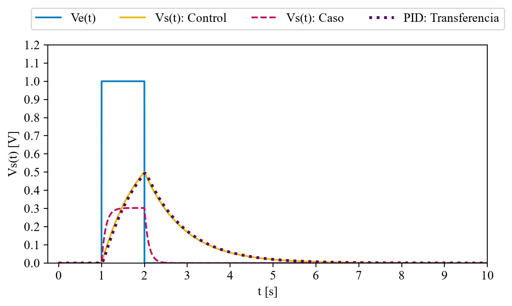
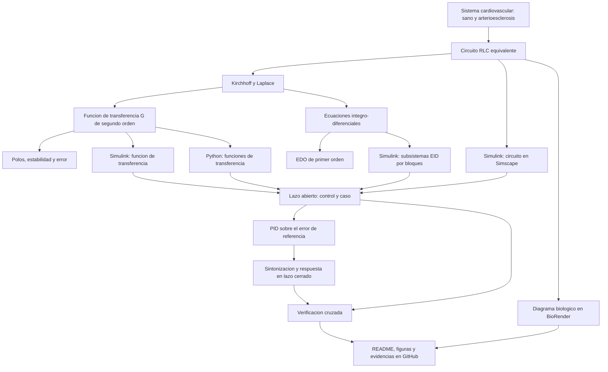

Proyecto Final: Modelado y control del sistema cardiovascular (arterioesclerosis)
[](https://matlab.mathworks.com/open/github/v1?repo=Nefga/MSFP5)
# Proyecto Final: Sistema cardiovascular-arterioesclerosis

## Información de los estudiantes
Neltzon Farid Garcia Altamirano\[23212194]; l23212194@tijuana.tecnm.mx

Castro Alcántar Daniel Hiram\[23212184]; l23212184@tijuana.tecnm.mx

Modelado de Sistemas Fisiológicos

Ingeniería Biomédica

Proyecto final desarrollado en equipo. Fecha de la bitácora: 19 de noviembre de 2026.

## Docente
Dr. Paul Antonio Valle Trujillo; paul.valle@tectijuana.edu.mx

Departamento de Ingeniería Eléctrica y Electrónica, Tecnológico Nacional de México/IT Tijuana, Blvd. Alberto Limón Padilla s/n, Tijuana, C.P. 22454, B.C., México.

Repositorio de la asignatura: https://github.com/DrPaulValle/MSF-IBF1020

## Descripción de la asignatura

El modelizado de sistemas fisiológicos es una herramienta importante en Ingeniería Biomédica, permite comprender el funcionamiento del cuerpo humano, así como diseñar y evaluar terapias y dispositivos médicos; se define como el proceso de formular modelos matemáticos o computacionales que representan el comportamiento y la interacción de los sistemas biológicos y fisiológicos. Esta asignatura pretende aportar al perfil del Ingeniero Biomédico la capacidad de realizar investigación científica en el área de Biología de Sistemas con la finalidad de dirigir y participar en equipos de trabajo interdisciplinarios en contextos nacionales e internacionales, así como de proporcionar soluciones informáticas para resolver problemas en el campo de la Ingeniería Biomédica con ética profesional; lo anterior al proporcionar al estudiante bases sólidas para modelizar sistemas y diseñar controladores para la solución de problemas en las áreas de atención médica y del sector industrial médico. La construcción de analogías entre circuitos eléctricos y sistemas fisiológicos para la formulación de modelos matemáticos y el diseño de controladores mediante la experimentación in silico brindan herramientas de gran aplicación en el quehacer profesional del Ingeniero Biomédico.

La asignatura de Modelado de Sistemas Fisiológicos forma parte del plan de estudios de la carrera en Ingeniería Biomédica con la siguiente competencia general del curso: Utiliza las propiedades de los circuitos RLC para describir la dinámica de sistemas fisiológicos, obtener modelos matemáticos y aplicar el control clásico, esto con el objetivo de integrar los principios de la Ingeniería de Control, la Electrónica Analógica y las Ciencias de la Computación con la Anatomía y Fisiología del cuerpo humano para proporcionar descripciones cuantitativas y cualitativas de sistemas fisiológicos complejos con el objetivo de modelizar, analizar, controlar, ilustrar y predecir su dinámica tanto en el corto como en el largo plazo.

## Objetivos

1. Calcular la función de transferencia.
2. Determinar el modelo de ecuaciones integro-diferenciales.
3. Establecer el sistema de ecuaciones diferenciales ordinarias lineales de primer orden.
4. Emular la respuesta del circuito RLC en Simulink/Simscape al escalón, impulso, rampa y función sinusoidal.
5. Simular la respuesta de los modelos matemáticos en Simulink/MATLAB al escalón, impulso, rampa y función sinusoidal.
6. Sintonizar las ganancias de un controlador PID para eliminar el error entre la entrada y la salida del sistema.
7. Obtener la respuesta en lazo abierto y en lazo cerrado con el controlador PID en Python con la función de transferencia.

## Descripción detallada del sistema

El sistema cardiovascular transporta sangre mediante la acción de bombeo del corazón y una red de vasos con propiedades mecánicas diferentes. Durante la sístole, las grandes arterias se expanden y almacenan parte del volumen expulsado; durante la diástole, su retroceso elástico contribuye a mantener el flujo. Esta propiedad, que se expresa mediante la compliancia arterial Ca = ΔV/ΔP, amortigua las fluctuaciones pulsátiles de presión. La arterioesclerosis designa, en sentido amplio, el engrosamiento y endurecimiento arterial con pérdida de elasticidad; al reducirse la capacidad de distensión, cambia la forma en que los vasos almacenan energía y responden ante variaciones rápidas de presión.

Un circuito RLC representa un sistema de segundo orden que modeliza, de manera simplificada, este comportamiento: Una fuente de voltaje controlada aplica Ve(t); los componentes R1 y L, en serie, representan la oposición resistiva y la inercia de la masa sanguínea en movimiento hasta el nodo intermedio A. El capacitor C1 se conecta de A a tierra y representa la capacidad de distensión de un compartimento arterial idealizado. El resistor R2 comunica A con el nodo final B, donde la resistencia de carga R3 se conecta a tierra y representa de forma concentrada la oposición equivalente aguas abajo. Un sensor mide la variable de salida Vs(t) entre B y la referencia. El objetivo del modelo eléctrico es predecir la respuesta dinámica de un sistema arterial idealizado ante una perturbación de presión. Se comparan una condición sana (control) y una condición con arterioesclerosis (caso), en la que se disminuye la capacitancia de C1 = 1000 µF a 100 µF y se aumenta la resistencia de R2 = 2.2 kΩ a 22 kΩ.

El proyecto se desarrolla exclusivamente mediante experimentación *in silico*; la estrategia de control tiene propósitos académicos y de simulación, y no constituye una estrategia terapéutica.

---

<a id="contenido"></a>
## Contenido

1. [Resumen](#resumen)
2. [Metas, competencia y objetivos](#objetivos)
3. [Relación con el temario](#temario)
4. [Modelo físico y analogía eléctrica](#analogia)
5. [Formulación matemática](#modelo)
6. [Análisis temporal y de estabilidad](#analisis)
7. [Señales de entrada y condiciones de simulación](#senales)
8. [Implementación en MATLAB, Simulink y Python](#matlab)
9. [Control en lazo cerrado y sintonización PID](#pid)
10. [Resultados e interpretación](#resultados)
11. [Limitaciones del modelo](#limitaciones)
12. [Conclusiones](#conclusiones)
13. [Flujo de trabajo](#flujo)
14. [Actividades del estudiante](#actividades)
15. [Estructura del repositorio](#estructura)
16. [Requisitos](#requisitos)
17. [Reproducibilidad y entregables](#reproducibilidad)
18. [Referencias](#referencias)

---

<a id="resumen"></a>
## Resumen

El proyecto tiene como propósito **modelar, analizar, simular y controlar** el sistema cardiovascular en condición sana y con arterioesclerosis a partir de un circuito eléctrico equivalente. La entrada $V_e(t)$ representa una perturbación de presión proximal; $R_1$ y $L$ forman el tramo de entrada, $C_1$ representa la distensibilidad arterial, $R_2$ comunica el nodo intermedio con el nodo final y $R_3$ es la carga resistiva terminal; la salida $V_s(t)$ es el voltaje del nodo final respecto de tierra. Al tener dos elementos independientes que almacenan energía ($L$ y $C_1$), el sistema es de **segundo orden**:

$$
\boxed{G(s)=\frac{V_s(s)}{V_e(s)}=\frac{R_3}{L\,C_1\,(R_2+R_3)\,s^{2}+\left[R_1C_1(R_2+R_3)+L\right]s+\left(R_1+R_2+R_3\right)}.}
$$

La condición **caso** (arterioesclerosis) se obtiene modificando dos componentes respecto del control, elegidos de manera heurística para producir respuestas distinguibles: $C_1$ disminuye $90\,\%$ (de $1000\,\mu\mathrm{F}$ a $100\,\mu\mathrm{F}$) y $R_2$ aumenta $900\,\%$ (de $2.2\,\mathrm{k}\Omega$ a $22\,\mathrm{k}\Omega$). Ante un escalón de $1\,\mathrm{V}$ el control se estabiliza en $0.758\,\mathrm{V}$ y el caso en $0.303\,\mathrm{V}$, y el caso alcanza su meseta mucho antes.

Se estudian el error en estado estacionario y la estabilidad a través de los polos de cada modelo. Un modelo de lenguaje (LLM) se utilizó para justificar el tipo de señal de entrada y la analogía del circuito con el sistema fisiológico. Posteriormente se contrastan tres representaciones del sistema en Simulink (circuito de Simscape, función de transferencia y ecuaciones integro-diferenciales por bloques) y una implementación en Python. Se incorpora un **controlador PID** cuya señal de error es la diferencia entre la respuesta del control (referencia) y la salida del lazo, con ganancias sintonizadas con la herramienta *Tune* de Simulink y una versión PI en Python.

El proyecto se desarrolla **exclusivamente mediante experimentación *in silico***. Los valores de los componentes son parámetros heurísticos expresados en unidades eléctricas y no proceden de mediciones de pacientes. La estrategia de control tiene propósitos académicos y de simulación, y no constituye una estrategia terapéutica.

**Palabras clave:** sistema cardiovascular; arterioesclerosis; compliancia arterial; circuito RLC; función de transferencia; segundo orden; controlador PID; MATLAB; Simulink; Python; simulación *in silico*.

[Volver al contenido](#contenido)

---

<a id="objetivos"></a>
## Metas, competencia y objetivos

### Metas de la bitácora

1. Seleccionar el sistema fisiológico y la enfermedad: sistema cardiovascular, arterioesclerosis.
2. Construir el circuito y diferenciar los valores del control y del caso. Los valores de los componentes se seleccionan de forma heurística para generar salidas diferentes.
3. Utilizar un LLM para justificar el tipo de señal de entrada y realizar la analogía del circuito con el sistema fisiológico, diferenciando entre el individuo sano (control) y el enfermo (caso).

### Competencia a desarrollar

Modelizar sistemas fisiológicos mediante analogías entre sistemas físicos, ecuaciones diferenciales y funciones de transferencia para analizar su comportamiento dinámico, y diseñar estrategias de control mediante técnicas de control clásico. En particular, se construye el circuito eléctrico equivalente del sistema cardiovascular, se comparan la condición sana y la condición con arterioesclerosis y se diseña una estrategia de control *in silico*.

### Objetivo general

Analizar y controlar el modelo eléctrico equivalente del sistema cardiovascular mediante su formulación matemática, su implementación computacional y el diseño de un controlador PID, comparando las respuestas del control, del caso y del sistema controlado.

### Objetivos específicos

- Identificar los elementos $V_e(t)$, $V_s(t)$, $R_1$, $L$, $C_1$, $R_2$, $R_3$, $i_1(t)$ e $i_2(t)$ del circuito.
- Justificar los valores de los parámetros del control y del caso y el tipo de señal de entrada.
- Obtener la función de transferencia aplicando la transformada de Laplace con condiciones iniciales nulas, para control y caso.
- Determinar el error en estado estacionario y analizar la estabilidad mediante los polos.
- Obtener el modelo de ecuaciones integro-diferenciales y el sistema de ecuaciones diferenciales ordinarias de primer orden.
- Implementar el sistema en Simulink (circuito, función de transferencia y ecuaciones integro-diferenciales) y en Python.
- Implementar un controlador PID, sintonizar sus ganancias con *Tune* y analizar la respuesta en lazo cerrado.
- Elaborar un diagrama biológico que relacione los elementos del modelo con el sistema cardiovascular.
- Interpretar el comportamiento de la salida y las limitaciones del modelo.
- Documentar el proyecto en un repositorio de GitHub.

[Volver al contenido](#contenido)

---

<a id="temario"></a>
## Relación con el temario

El proyecto integra contenidos correspondientes a tres unidades de la asignatura **Modelado de Sistemas Fisiológicos (IBF-1020)**:

| Unidad | Área | Contenidos aplicados |
|---|---|---|
| I | Sistemas de control retroalimentados | Diagramas de bloques, respuesta ante un escalón y un pulso, análisis de error y criterios de estabilidad |
| II | Modelado matemático | Analogía eléctrica, transformada de Laplace, función de transferencia de segundo orden y ecuaciones integro-diferenciales |
| III | Controladores | Controlador PID, diseño y sintonización de ganancias |

El enfoque combina **Ingeniería de Control, Electrónica Analógica, Ciencias de la Computación y Fisiología**, de acuerdo con la competencia general de la asignatura.

[Volver al contenido](#contenido)

---

<a id="analogia"></a>
## Modelo físico y analogía eléctrica

El modelo se implementa en MATLAB/Simulink mediante dos subsistemas con **idéntica topología**. Una fuente de voltaje controlada aplica $V_e(t)$; $R_1$ y $L$ están en serie hasta el nodo intermedio A, al que se conecta $C_1$ hacia tierra. $R_2$ comunica A con el nodo final B, donde la resistencia de carga $R_3$ se conecta a tierra. Un sensor mide $V_s(t)$ entre B y la referencia. Esta red conserva dos mallas y tiene dinámica de segundo orden, por incorporar un inductor y un capacitor.

```text
          R1          L        nodo A         R2       nodo B
 (+)●────/\/\/──────mmmm────────●──────────/\/\/──────●──────┐
    │   →i1(t)                   │                    │      │
  Ve(t)                         ===C1                 R3    (V) Vs(t)
    │                            │                    │      │
 (−)●                            │                    │      │
    └────────────────────────────┴────────────────────┴──────┘
                          referencia (0 V)
```

El circuito se construyó en Simscape con los convertidores Simulink–PS y PS–Simulink y el bloque *Solver Configuration*, que solo permiten la simulación. La analogía presión–voltaje y flujo–corriente es habitual en modelos circulatorios concentrados. La red propuesta **no es idéntica al Windkessel clásico**, aunque incorpora una carga resistiva terminal.

### Correspondencia entre el circuito y el sistema cardiovascular

| Elemento | Función eléctrica | Interpretación y alcance de la analogía |
|---|---|---|
| $R_1$, $R_2$ | Oponen resistencia al paso de corriente | Aproximan pérdidas de presión asociadas al flujo; no son resistencias vasculares medidas |
| $R_3$ | Carga resistiva terminal que permite circulación continua | Representa de forma concentrada una oposición equivalente aguas abajo |
| $L$ | Se opone a variaciones rápidas de corriente | Análoga a la inercia de la masa sanguínea en movimiento |
| $C_1$ | Almacena carga y modifica el transitorio | Aproxima la capacidad de distensión de un compartimento arterial idealizado |
| $V_e$, $V_s$ | Voltajes de entrada y salida | Variables análogas a presión proximal y distal, sin conversión directa V–mmHg |

### Diagrama biológico

<p align="center">
  
</p>

*Figura elaborada en BioRender. Cada etapa del sistema cardiovascular se relaciona con su elemento del circuito: la excitación del corazón ($V_e(t)$, presión/flujo), el transporte sanguíneo con inercia ($L$), la distensibilidad arterial o compliancia ($C_1$), la resistencia vascular ($R_1$, $R_2$ y $R_3$) y la presión arterial distal como voltaje de salida ($V_s(t)$). La figura incluye la tabla de parámetros del control y del caso y el circuito equivalente.*

### Justificación de los parámetros del control y del caso

Los valores se eligieron de manera heurística para diferenciar las respuestas y se expresan en unidades eléctricas; no proceden de mediciones de pacientes. Las conexiones son exactamente iguales en control y caso.

| Componente | Control (sano) | Caso (arterioesclerosis) | Cambio |
|---|---:|---:|---|
| $R_1$ | $1\ \mathrm{k}\Omega$ | $1\ \mathrm{k}\Omega$ | Sin cambio |
| $L$ | $100\ \mathrm{mH}$ | $100\ \mathrm{mH}$ | Sin cambio |
| $R_2$ | $2.2\ \mathrm{k}\Omega$ | $22\ \mathrm{k}\Omega$ | Aumenta $900\ \%$ |
| $C_1$ | $1000\ \mu\mathrm{F}$ | $100\ \mu\mathrm{F}$ | Disminuye $90\ \%$ |
| $R_3$ | $10\ \mathrm{k}\Omega$ | $10\ \mathrm{k}\Omega$ | Sin cambio |

- **$C_1$:** la menor capacitancia es congruente, como analogía, con la rigidez arterial: una arteria rígida se distiende menos ante un cambio de presión.
- **$R_2$:** el aumento se eligió para crear un contraste eléctrico adicional que permite separar también los valores finales; no implica que la arterioesclerosis siempre multiplique por diez la resistencia vascular.
- Los porcentajes no indican gravedad clínica ni se derivan de datos experimentales. La combinación de menor capacitancia y mayor resistencia es una hipótesis didáctica, no un patrón clínico obligatorio.

> **Alcance de la analogía:** los valores corresponden al circuito eléctrico equivalente empleado para la experimentación *in silico*. La analogía conserva la estructura matemática, pero no debe interpretarse como una conversión numérica directa a unidades fisiológicas.

[Volver al contenido](#contenido)

---

<a id="modelo"></a>
## Formulación matemática

### 1. Ecuaciones principales

Con $i_1(t)$ la corriente de entrada ($F_e$) e $i_2(t)$ la corriente de la rama formada por $R_2$ y $R_3$ ($F_s$):

$$
V_e(t)=R_1i_1(t)+L\frac{di_1(t)}{dt}+\frac{1}{C_1}\int_0^t\left[i_1(\tau)-i_2(\tau)\right]d\tau,
$$

$$
\frac{1}{C_1}\int_0^t\left[i_1(\tau)-i_2(\tau)\right]d\tau=\left(R_2+R_3\right)i_2(t),\qquad V_s(t)=R_3\,i_2(t).
$$

### 2. Transformada de Laplace

Con condiciones iniciales nulas:

$$
V_e(s)=\left(R_1+Ls\right)F_e(s)+\frac{F_e(s)-F_s(s)}{C_1s},\qquad
\frac{F_e(s)-F_s(s)}{C_1s}=\left(R_2+R_3\right)F_s(s),\qquad V_s(s)=R_3F_s(s).
$$

### 3. Función de transferencia

De la segunda ecuación, $F_e(s)-F_s(s)=C_1s\,(R_2+R_3)F_s(s)$, por lo que

$$
F_e(s)=\left[C_1s\,(R_2+R_3)+1\right]F_s(s).
$$

Sustituyendo en la primera ecuación:

$$
V_e(s)=\left(R_1+Ls\right)\left[C_1s\,(R_2+R_3)+1\right]F_s(s)+\left(R_2+R_3\right)F_s(s).
$$

Expandiendo el producto $(R_1+Ls)[C_1(R_2+R_3)s+1]=R_1C_1(R_2+R_3)s+R_1+LC_1(R_2+R_3)s^2+Ls$ y agrupando por potencias de $s$:

$$
V_e(s)=\left[LC_1(R_2+R_3)\,s^{2}+\left(R_1C_1(R_2+R_3)+L\right)s+\left(R_1+R_2+R_3\right)\right]F_s(s).
$$

Como $V_s(s)=R_3F_s(s)$:

$$
\boxed{G(s)=\frac{V_s(s)}{V_e(s)}=\frac{R_3}{LC_1(R_2+R_3)\,s^{2}+\left[R_1C_1(R_2+R_3)+L\right]s+\left(R_1+R_2+R_3\right)}.}
$$

Sustituyendo los valores de cada condición:

$$
G_{control}(s)=\frac{10\,000}{1.22\,s^{2}+12\,200.1\,s+13\,200},\qquad
G_{caso}(s)=\frac{10\,000}{0.32\,s^{2}+3200.1\,s+33\,000}.
$$

### 4. Orden del sistema

El denominador es de grado 2 en ambas condiciones. $L$ almacena energía en su campo magnético (estado $i_1$) y $C_1$ en su campo eléctrico (estado $V_C$); son dos elementos independientes que almacenan energía, por lo que el sistema es de **segundo orden**. Los resistores solo disipan y no aumentan el orden. El numerador es constante, por lo que $G(s)$ no tiene ceros.

### 5. Verificación por planteamiento nodal

Sean $V_A$ el voltaje del nodo intermedio y $V_s$ el voltaje del nodo de salida. Con condiciones iniciales nulas, las leyes de Kirchhoff en el dominio de Laplace dan

$$
\frac{V_e-V_A}{R_1+sL}=sC_1V_A+\frac{V_A-V_s}{R_2},\qquad \frac{V_A-V_s}{R_2}=\frac{V_s}{R_3}.
$$

De la segunda ecuación, $V_A=V_s\,(R_2+R_3)/R_3$. Sustituyendo en la primera y despejando $V_e$:

$$
V_e=V_s\,\frac{(R_2+R_3)+(R_1+sL)\left[C_1(R_2+R_3)s+1\right]}{R_3},
$$

que conduce a la misma función de transferencia. En $s=0$ se obtiene $G(0)=R_3/(R_1+R_2+R_3)$, el divisor resistivo esperado.

### 6. Modelo de ecuaciones integro-diferenciales

Despejando las variables de cada ecuación:

$$
\frac{di_1(t)}{dt}=\frac{1}{L}\left[V_e(t)-R_1i_1(t)-\frac{1}{C_1}\int_0^t\left[i_1(\tau)-i_2(\tau)\right]d\tau\right],
$$

$$
i_2(t)=\frac{1}{R_2+R_3}\,\frac{1}{C_1}\int_0^t\left[i_1(\tau)-i_2(\tau)\right]d\tau,\qquad V_s(t)=R_3\,i_2(t).
$$

### 7. Sistema de ecuaciones diferenciales ordinarias de primer orden

Con $V_C(t)=\dfrac{1}{C_1}\displaystyle\int_0^t\left[i_1-i_2\right]d\tau$ como segunda variable de estado, $i_2=V_C/(R_2+R_3)$ y

$$
\frac{di_1(t)}{dt}=\frac{V_e(t)-R_1\,i_1(t)-V_C(t)}{L},\qquad
\frac{dV_C(t)}{dt}=\frac{1}{C_1}\left[i_1(t)-\frac{V_C(t)}{R_2+R_3}\right],\qquad
V_s(t)=\frac{R_3}{R_2+R_3}\,V_C(t).
$$

Este es el modelo que se implementa por bloques (ganancias $1/L$, $1/C_1$, $1/(R_2+R_3)$, integradores y la ganancia $R_3$) en los subsistemas `EID` de Simulink.

[Volver al contenido](#contenido)

---

<a id="analisis"></a>
## Análisis temporal y de estabilidad

### 1. Estabilidad en lazo abierto

Con $a=LC_1(R_2+R_3)$, $b=R_1C_1(R_2+R_3)+L$ y $c=R_1+R_2+R_3$, los polos se obtienen de $\lambda=\dfrac{-b\pm\sqrt{b^2-4ac}}{2a}$.

| Característica | Control | Caso |
|---|---:|---:|
| $a$ | $1.22$ | $0.32$ |
| $b$ | $12\,200.1$ | $3200.1$ |
| $c$ | $13\,200$ | $33\,000$ |
| $b^2-4ac$ | $148\,778\,024$ | $10\,198\,400$ |
| Polos | $-1.082$ y $-9999.0\ \mathrm{s^{-1}}$ | $-10.323$ y $-9990.0\ \mathrm{s^{-1}}$ |
| Constante de tiempo dominante | $\approx0.92\,\mathrm{s}$ | $\approx0.097\,\mathrm{s}$ |
| Ganancia $G(0)=R_3/(R_1+R_2+R_3)$ | $0.7576$ | $0.3030$ |

En ambos casos $b^2-4ac>0$: las raíces son reales, distintas y negativas, por lo que las respuestas son **estables y sobreamortiguadas**. El polo muy rápido (del orden de $10^4\,\mathrm{s^{-1}}$) está vinculado con la pequeña inductancia del modelo; el polo lento determina gran parte de la curva visible.

### 2. Error en estado estacionario

Se define $e(t)=V_e(t)-V_s(t)$. Para una entrada escalón unitario, $V_e(s)=1/s$, y aplicando el teorema del valor final (válido porque los polos son negativos):

$$
\boxed{e_{ss}=\lim_{s\to0}s\,V_e(s)\left[1-G(s)\right]=1-\frac{R_3}{R_1+R_2+R_3}.}
$$

| | $V_s(\infty)$ | $e_{ss}$ | $e_{ss}$ (%) |
|---|---:|---:|---:|
| Control | $\dfrac{10\,000}{13\,200}=0.7576\ \mathrm{V}$ | $0.2424\ \mathrm{V}$ | $24.24\ \%$ |
| Caso | $\dfrac{10\,000}{33\,000}=0.3030\ \mathrm{V}$ | $0.6970\ \mathrm{V}$ | $69.70\ \%$ |

La presencia de $R_3$ permite mantener corriente en régimen estacionario y genera un divisor de tensión: $V_s(\infty)=V_e(\infty)\,R_3/(R_1+R_2+R_3)$. La separación entre las mesetas del control y del caso es de aproximadamente $0.455\ \mathrm{V}$.

### 3. Tiempo de establecimiento

Con el criterio de $\pm2\ \%$, contado desde el escalón, $t_s\approx3.91\,\tau$ para el polo dominante:

| | Control | Caso |
|---|---:|---:|
| Tiempo de establecimiento teórico | $\approx3.62\ \mathrm{s}$ | $\approx0.38\ \mathrm{s}$ |

Son estimaciones del modelo matemático, no mediciones directas del Scope.

### 4. Predicción previa

Ante un escalón de $1\,\mathrm{V}$ aplicado en $t=1\,\mathrm{s}$ se espera:

- que $G(s)$ no tiene ceros y su grado relativo es 2, por lo que la salida inicia suave, sin saltos;
- el control creciendo con $\tau\approx0.92\,\mathrm{s}$ hasta $0.7576\,\mathrm{V}$;
- el caso creciendo con $\tau\approx0.097\,\mathrm{s}$ y alcanzando antes su meseta, de menor amplitud, en $0.3030\,\mathrm{V}$.

#### Ejemplo mínimo de verificación en Python

```python
import control as ctrl

R1, R2, R3, L, C1 = 1e3, 2.2e3, 10e3, 100e-3, 1000e-6
Gcontrol = ctrl.tf([R3], [L*C1*(R2+R3), R1*C1*(R2+R3)+L, R1+R2+R3])

R2, C1 = 22e3, 100e-6
Gcaso = ctrl.tf([R3], [L*C1*(R2+R3), R1*C1*(R2+R3)+L, R1+R2+R3])

print(ctrl.poles(Gcontrol), ctrl.poles(Gcaso))
```

[Volver al contenido](#contenido)

---

<a id="senales"></a>
## Señales de entrada y condiciones de simulación

### Selección y justificación de la señal de entrada

Se consideraron cinco alternativas:

| Señal | Ventaja | Limitación |
|---|---|---|
| Escalón | Facilita comparar ganancia, rapidez y estabilidad | No representa una presión cardíaca real sostenida |
| Pulso rectangular | Permite observar carga y recuperación | Mayor complejidad de interpretación inicial |
| Sinusoide | Útil para evaluar ganancia y desfase | Requiere analizar la respuesta en frecuencia |
| Rampa | Analiza cambios progresivos | No tiene un análogo fisiológico directo |
| Señal pseudoaleatoria | Puede explorar múltiples frecuencias | Complica la interpretación fisiológica inicial |

Se utiliza el **escalón** como ensayo principal, de amplitud $1\,\mathrm{V}$, aplicación en $t_0=1\,\mathrm{s}$ y simulación de $0$ a $10\,\mathrm{s}$:

$$
V_e(t)=1\,\mathrm{V}\;u(t-1\,\mathrm{s}).
$$

Como ensayo adicional puede aplicarse un tren de pulsos de $1\,\mathrm{V}$, periodo $2\,\mathrm{s}$, ancho del $50\,\%$ y retardo inicial de $1\,\mathrm{s}$. Estas magnitudes son estímulos eléctricos normalizados, sin equivalencia directa con mmHg o con frecuencia cardíaca real.

### Condiciones de simulación

El intervalo de simulación es $0\le t\le10\,\mathrm{s}$. Se establece un **paso máximo** de $\Delta t=10^{-3}\,\mathrm{s}$ y el solver `ode15s` en Simulink.

| Señal | Definición para la simulación | Propósito |
|---|---|---|
| Escalón | Amplitud $1\,\mathrm{V}$, inicio en $t=1\,\mathrm{s}$ | Comparar ganancia, rapidez y estabilidad del control y del caso |
| Pulso | Amplitud $1\,\mathrm{V}$, duración $1\,\mathrm{s}$, inicio en $t=1\,\mathrm{s}$ (periodo $10\,\mathrm{s}$, ancho $10\,\%$, retardo $1\,\mathrm{s}$) | Examinar la respuesta ante una perturbación de duración finita y evaluar el controlador |

La misma señal se aplica al control, al caso y al sistema con controlador, con condiciones iniciales nulas, para que las respuestas sean comparables. En Python el pulso se construye con `u[round(1/dt):round(2/dt)] = 1` y $\Delta t=10^{-3}\,\mathrm{s}$.

[Volver al contenido](#contenido)

---

<a id="matlab"></a>
## Implementación en MATLAB, Simulink y Python

El modelo de Simulink (`Sistema.slx`) contiene los subsistemas `CONTROL - SANO` y `CASO - ARTERIOESCLEROSIS`, cada uno con tres representaciones del mismo circuito:

| Representación | Descripción |
|---|---|
| Circuito (`CE`) | Circuito de Simscape con `R1`, `L`, `C1`, `R2` y `R3`, fuente de voltaje controlada, sensor de voltaje y referencia eléctrica |
| Función de transferencia (`FT`) | Bloque `Transfer Fcn` con los coeficientes de cada condición |
| Ecuaciones integro-diferenciales (`EID`) | Ganancias, sumadores e integradores que implementan el modelo de la sección 7 |

| Elemento | Bloque | Descripción |
|---|---|---|
| Entrada | `Discrete Pulse Generator` | Señal de $1\,\mathrm{V}$ aplicada en $t=1\,\mathrm{s}$ |
| Lazo con PID | `Sum`, `PID Controller` y función de transferencia dentro de `CASO - ARTERIOESCLEROSIS` | El `Sum` calcula $e(t)=x_{control}(t)-x_{lazo}(t)$ y el PID genera la señal de control |
| Registro de señales | `To Workspace` | Variables `Ve` (entrada), `Fe` (control), `Fs` (caso en lazo abierto) y `PID` (salida con controlador) |

Las funciones de transferencia se escriben con los coeficientes de la sección [Formulación matemática](#modelo):

| Condición | Numerador | Denominador |
|---|---|---|
| Control | `10000` | `[1.22, 12200.1, 13200]` |
| Caso | `10000` | `[0.32, 3200.1, 33000]` |

### Ejecución desde el cuaderno MATLAB

El cuaderno (`MSFPF.mlx`) ejecuta el modelo de Simulink, recupera las señales en el *Workspace* y las grafica con la función `plotsignals`.

#### Datos de la simulación

```matlab
clc; clear; close all; warning('off','all')
open_system('Sistema')
parameters.StopTime = '10';
parameters.Solver = 'ode15s';
parameters.MaxStep = '1e-3';
x = sim('Sistema',parameters);
```

#### Respuesta de la simulación

```matlab
plotsignals(x.t,x.Ve,x.Fe,x.Fs,x.PID,'Control y caso')
```

#### Función de graficación

```matlab
function plotsignals(t,s,s1,s2,s3,signal)
    set(figure(),'color','w')
    set(gcf,'units','inches','position',[1,1,11,4.5])
    set(gca,'fontname','times new roman','fontsize',11)
    hold on; grid off; box on;

    clr1 = [46, 41, 16]/255;
    clr2 = [235, 125, 0]/255;
    clr3 = [235, 227, 167]/255;
    clr4 = [44, 87, 69]/255;
    order = [clr1;clr2;clr3;clr4]; colororder(order)

    if signal == "Control y caso"
        plot(t,s,'-',t,s1,'-',t,s2,'-',t,s3,'--', ...
            'LineWidth',1.5,'MarkerSize',5, ...
            'MarkerIndices',1:1e3:length(t));
        l = legend('$V_e(t)$','$V_s(t)$: Control', ...
            '$V_s(t)$: Caso','$PID(t)$');
    end

    set(l,'interpreter','latex','location','northoutside','orientation','horizontal')

    xlabel('$t$ [s]','interpreter','latex')
    ylabel('$V(t)$ [V]','interpreter','latex')

    xlim([0 10]); xticks(0:1:15)
    ylim([-0.1 1.1]); yticks(-0.1:0.1:1.1)
    exportgraphics(gcf,[signal,'.matlab.pdf'],'contenttype','vector')
end
```

La función grafica la entrada, el control, el caso y la respuesta con PID, identifica las variables y sus unidades, y guarda la figura en PDF vectorial.

### Implementación en Python

El archivo `proyecto.py` obtiene la respuesta en lazo abierto y en lazo cerrado con las funciones de transferencia, usando la librería `control`.

```python
#Librerías
import numpy as np
import control as ctrl
import matplotlib.pyplot as plt

#Datos Generales de la Simulacion
x0,t0,tend,dt,w,h = 0,0,10,1E-3,7,3.5
N = round(tend/dt)+1
t = np.linspace(t0,tend,N)
u = np.zeros(N)
u[round(1/dt):round(2/dt)] = 1

#Componentes Circuito
R1,R2,R3,L,C1 = 1E3,2.2E3,10E3,100E-3,1000E-6
R2caso,C1caso = 22E3,100E-6
sys = ctrl.tf([R3],[L*C1*(R2+R3),L+R1*C1*(R2+R3),R1+R2+R3])
sysCaso = ctrl.tf([R3],[L*C1caso*(R2caso+R3),L+R1*C1caso*(R2caso+R3),R1+R2caso+R3])

#Componentes del controlador
kP,kI,kD = 10,103.23,0
PID = ctrl.tf([kD,kP,kI],[1,0])

#Sistema de control en lazo cerrado
sysPID = ctrl.feedback(ctrl.series(PID,sysCaso),1,sign=-1)

#Respuestas
_,VsX = ctrl.forced_response(sys,t,u,x0)
_,VsY = ctrl.forced_response(sysCaso,t,u,x0)
_,PIDu = ctrl.forced_response(sysPID,t,VsX,x0)
```

La respuesta del controlador se calcula aplicando como referencia la salida del control (`VsX`) al lazo cerrado formado por el PID y el caso. El resto del archivo grafica las cuatro señales y guarda la figura como `practica_python.pdf` y `practica_python.png`.

[Volver al contenido](#contenido)

---

<a id="pid"></a>
## Control en lazo cerrado y sintonización PID

### 1. Retroalimentación negativa

La respuesta de la condición control (sana) se utiliza como **referencia**. El controlador PID actúa sobre la señal de error

$$
e(t)=x_{control}(t)-x_{lazo}(t),
$$

con ley de control

$$
u(t)=k_Pe(t)+k_I\int_0^t e(\tau)\,d\tau+k_D\frac{de(t)}{dt},
\qquad
K(s)=k_P+\frac{k_I}{s}+\frac{k_D\,N\,s}{s+N}.
$$

Con retroalimentación negativa unitaria, la salida del lazo es

$$
x_{lazo}(s)=\frac{K(s)G_p(s)}{1+K(s)G_p(s)}\,x_{control}(s)=T(s)\,x_{control}(s),
$$

donde $G_p(s)$ es la función de transferencia del bloque de planta dentro del lazo.

### 2. Sintonización en Simulink

Se utiliza la opción **Tune** del bloque `PID Controller` de Simulink (tipo PIDF, forma paralela, tiempo continuo). Las ganancias obtenidas son:

| Ganancia | Valor |
|---|---:|
| $k_P$ | $26\,370.7413$ |
| $k_I$ | $43\,149\,447.1245$ |
| $k_D$ | $2.7799$ |
| $N$ (filtro derivativo) | $2\,520\,772.1222$ |

Desempeño reportado por la herramienta *PID Tuner* para el seguimiento de referencia:

| Métrica | Valor |
|---|---:|
| Tiempo de subida | $9.29\times10^{-5}\ \mathrm{s}$ |
| Tiempo de establecimiento | $0.00101\ \mathrm{s}$ |
| Sobreimpulso | $5.63\ \%$ |
| Pico | $1.06$ |
| Margen de ganancia | $\infty$ |
| Margen de fase | $90^\circ$ a $2.21\times10^{4}\ \mathrm{rad/s}$ |
| Estabilidad en lazo cerrado | Estable |

<p align="center">
  
</p>

### 3. Función de transferencia del lazo

El lazo cerrado $T(s)$ del modelo de Simulink tiene:

| Característica | Valor |
|---|---|
| Polos | $-2\,497\,684$, $-24\,904$, $-5646$ y $-2539$ |
| Ceros | $-7354$ y $-2103$ |
| Ganancia en estado estacionario $T(0)$ | $1$ |

- $T(0)=1$: gracias a la acción integral, la salida alcanza sin error el valor de la referencia ante una entrada constante.
- Todos los polos son reales y negativos, por lo que el sistema controlado es estable.
- Los polos del lazo están entre $2.5\times10^{3}$ y $2.5\times10^{6}\,\mathrm{s^{-1}}$, mucho más rápidos que los del caso en lazo abierto ($-10.3$ y $-9990$), por lo que la salida sigue a la referencia casi sin retardo.

### 4. Controlador PI en Python

En Python se utiliza un controlador PI con $k_P=10$, $k_I=103.23$ y $k_D=0$ aplicado sobre el caso. El cociente $k_I/k_P=10.323$ coincide con el valor absoluto del polo lento del caso ($-10.3228$), por lo que el cero del PI cancela ese polo. El lazo cerrado resultante tiene polos en $-9958.6$, $-31.4$ y $-10.3$, y un cero en $-10.3$ que se cancela con el último polo, de modo que la dinámica efectiva queda determinada por los polos $-31.4$ y $-9958.6$, con $T(0)=1$.

[Volver al contenido](#contenido)

---

<a id="resultados"></a>
## Resultados e interpretación

Las respuestas permiten contrastar **entrada, control, caso en lazo abierto y salida con controlador**.

### Respuesta al escalón de 1 V (Scope de Simulink)

$V_s(t)$ es el voltaje del nodo B medido respecto a tierra, interpretado cualitativamente como una respuesta de presión distal. La captura del Scope muestra el escalón aplicado en $t=1\,\mathrm{s}$: la curva del control asciende gradualmente hasta su meseta y la del caso alcanza antes la suya, de menor amplitud.

| Magnitud | Control (sano) | Caso (arterioesclerosis) |
|---|---:|---:|
| Valor final $V_s(\infty)$ | $\approx0.758\ \mathrm{V}$ | $\approx0.303\ \mathrm{V}$ |
| Tiempo de establecimiento ($\pm2\ \%$) | $\approx3.62\ \mathrm{s}$ | $\approx0.38\ \mathrm{s}$ |

Las mesetas teóricas coinciden con las visibles en la captura, y la separación entre ellas es de aproximadamente $0.455\ \mathrm{V}$. La salida menor en el caso no significa que las personas con arterioesclerosis tengan necesariamente menor presión arterial: resulta de la mayor resistencia $R_2$, de la ubicación del sensor y de mantener fija la misma entrada de voltaje.

### Respuesta al pulso de 1 V y 1 s con controlador

La convención gráfica de `plotsignals` es:

- **Negro:** entrada aplicada, $V_e(t)$.
- **Naranja:** respuesta del control (sano), $V_s(t)$.
- **Amarillo claro:** respuesta del caso (arterioesclerosis) en lazo abierto, $V_s(t)$.
- **Verde oscuro discontinuo:** respuesta con PID.

La figura de Python usa azul para la entrada, amarillo para el control, rojo discontinuo para el caso y morado punteado para la respuesta del PID.

<p align="center">
  
</p>

| Magnitud | Control | Caso |
|---|---:|---:|
| Valor máximo | $\approx0.50\ \mathrm{V}$ (al terminar el pulso, $t=2\,\mathrm{s}$) | $\approx0.30\ \mathrm{V}$ (meseta) |
| Tiempo para llegar a la meseta | No la alcanza durante el pulso | $\approx0.5\ \mathrm{s}$ |
| Regreso a cero después del pulso | $\approx4\tau\approx3.7\ \mathrm{s}$ | $\approx0.4\ \mathrm{s}$ |

### Efecto del controlador

Diferencia entre la respuesta de referencia (control) y la del caso, sin y con controlador:

| Métrica | Caso en lazo abierto | Con PID (Simulink) | Con PI (Python) |
|---|---:|---:|---:|
| Valor máximo de la salida | $0.303\ \mathrm{V}$ | $0.5007\ \mathrm{V}$ | $0.4935\ \mathrm{V}$ |
| Error máximo respecto al control | $0.365\ \mathrm{V}$ | $4.2\times10^{-6}\ \mathrm{V}$ | $0.023\ \mathrm{V}$ |
| Integral del error cuadrático $\int e^2\,dt$ | $0.105$ | $5.1\times10^{-14}$ | $4.0\times10^{-4}$ |

Con cualquiera de los dos controladores, la salida del caso sigue prácticamente la misma curva que el control. El PID de Simulink reproduce la referencia con un error del orden de microvolts, mientras que el PI de Python, con ganancias mucho menores, mantiene un error máximo de $0.023\ \mathrm{V}$ que aparece en los cambios de pendiente de la referencia.

### Archivos de resultados

| Representación | Archivo |
|---|---|
| Respuesta en MATLAB/Simulink (control, caso y PID) | [`Control_y_caso_matlab_1.pdf`](Control_y_caso_matlab_1.pdf) |
| Respuesta en Python (control, caso y PID) | [`practica_python.pdf`](practica_python.pdf) |
| Cuaderno de MATLAB exportado | [`MSFPF.pdf`](MSFPF.pdf) |
| Análisis matemático | [`Análisismate.pdf`](Análisismate.pdf) |
| Bitácora del proyecto | [`Bitacora_parte1.pdf`](Bitacora_parte1.pdf) |

### Discusión

- **Efecto de $R_2$ y $C_1$.** El aumento de $R_2$ de $2.2\,\mathrm{k}\Omega$ a $22\,\mathrm{k}\Omega$ reduce la ganancia en estado estacionario de $0.758$ a $0.303$, y la disminución de $C_1$ de $1000\,\mu\mathrm{F}$ a $100\,\mu\mathrm{F}$ acelera la respuesta (de $\tau\approx0.92\,\mathrm{s}$ a $\approx0.097\,\mathrm{s}$). La salida del caso es más pequeña y se estabiliza antes.
- **Orden del sistema.** Ambos modelos son de segundo orden por la presencia de $L$ y $C_1$, pero el polo rápido ($\approx10^4\,\mathrm{s^{-1}}$) casi no se aprecia a la escala de segundos, y la respuesta es dominada por el polo lento.
- **Estabilidad.** Todos los polos son reales y negativos en lazo abierto; ninguna condición es oscilatoria.
- **Error.** El error en estado estacionario sube de $24.24\,\%$ (control) a $69.70\,\%$ (caso). La acción integral del controlador lo lleva a cero respecto de la referencia.
- **Consistencia entre representaciones.** El circuito de Simscape, la función de transferencia y las ecuaciones integro-diferenciales describen la misma dinámica de segundo orden, y la implementación en Python reproduce la respuesta de MATLAB/Simulink.
- **Alcance.** El controlador se diseñó con fines académicos y de simulación; no constituye una estrategia terapéutica.

[Volver al contenido](#contenido)

---

<a id="limitaciones"></a>
## Limitaciones del modelo

- La red representa un sistema concentrado ideal, no arterias con dimensiones, elasticidad, viscosidad y geometría medidas.
- La conversión presión–voltaje es solo una analogía: las capacitancias no se transforman automáticamente en compliancia clínica.
- No se modelan la no linealidad de la pared, la propagación y reflexión de ondas, el tono vasomotor, la autorregulación, la pulsación cardíaca real ni el acoplamiento ventrículo–arterial.
- $R_3$ agrupa en una carga simplificada la circulación distal y permite distinguir niveles finales, pero no representa un segmento anatómico específico.
- Los parámetros fueron elegidos para facilitar la comparación gráfica. La combinación de rigidez aumentada y $R_2$ mayor no constituye una predicción clínica universal.
- Las curvas son resultados de Simulink para ese conjunto de elementos y valores, no evidencia de validación frente a registros hemodinámicos de pacientes.

[Volver al contenido](#contenido)

---

<a id="conclusiones"></a>
## Conclusiones

El circuito RLC definitivo conserva dos mallas y una topología idéntica para control y caso. Al sustituir el capacitor terminal anterior por la resistencia $R_3$ en ambos modelos, el sistema pasa a ser de segundo orden y puede presentar distintos voltajes finales. Con las variaciones heurísticas de $C_1$ y $R_2$, las ecuaciones predicen aproximadamente $0.758\,\mathrm{V}$ para el control y $0.303\,\mathrm{V}$ para el caso, de acuerdo con el Scope presentado. El caso responde más rápido y alcanza una salida menor. El controlador PID sintonizado lleva la respuesta del caso hasta la del control. El modelo ilustra relaciones entre almacenamiento, resistencia e inercia, pero no cuantifica gravedad clínica ni reemplaza una validación fisiológica.

[Volver al contenido](#contenido)

---

<a id="flujo"></a>
## Flujo de trabajo



El procedimiento integra la formulación analítica y la experimentación *in silico* con una verificación cruzada entre las representaciones del modelo.

[Volver al contenido](#contenido)

---

<a id="actividades"></a>
## Actividades del estudiante

El proyecto sigue una secuencia de **modelado, simulación, control y documentación**, desarrollada exclusivamente *in silico*.

### Etapa 1. Selección y formulación

- [x] Seleccionar el sistema fisiológico y la enfermedad.
- [x] Construir el circuito y diferenciar los valores del control y del caso.
- [x] Utilizar un LLM para justificar la señal de entrada y la analogía del circuito con el sistema fisiológico.
- [x] Obtener $G(s)$ para el control y el caso con Laplace.
- [x] Calcular los polos y analizar la estabilidad en lazo abierto.
- [x] Calcular el error en estado estacionario.
- [x] Obtener el modelo de ecuaciones integro-diferenciales y el sistema de ecuaciones diferenciales de primer orden.

### Etapa 2. Simulación del sistema

- [x] Implementar el circuito en Simscape, la función de transferencia y las ecuaciones integro-diferenciales en Simulink.
- [x] Obtener la respuesta en lazo abierto del control y del caso.
- [x] Implementar las funciones de transferencia en Python.

### Etapa 3. Diseño y comprobación del controlador

- [x] Construir el sistema de retroalimentación con PID.
- [x] Sintonizar y registrar $k_P$, $k_I$, $k_D$ y $N$.
- [x] Obtener la respuesta en lazo cerrado en Simulink y en Python.
- [x] Desarrollar el cuaderno de MATLAB y la función de graficación con exportación a PDF.

### Etapa 4. Documentación

- [x] Elaborar el diagrama biológico en BioRender.
- [x] Documentar el análisis matemático y la bitácora.
- [x] Interpretar el comportamiento de la salida y las limitaciones del modelo.
- [x] Documentar el proyecto en este README.

[Volver al contenido](#contenido)

---

<a id="estructura"></a>
## Estructura del repositorio

```text
.
├── README.md                             # Reporte del proyecto
├── Sistema.slx                           # Modelo Simulink
├── MSFPF.mlx                             # Cuaderno de MATLAB
├── MSFPF.pdf                             # Cuaderno exportado
├── proyecto.py                           # Implementación en Python
├── practica_python.pdf                   # Figura de la respuesta en Python
├── Control_y_caso_matlab_1.pdf           # Figura de la respuesta en MATLAB/Simulink
├── Análisismate.pdf                      # Análisis matemático
├── Bitacora_parte1.pdf                   # Bitácora del proyecto
├── Parametros controlador PID.jpeg       # Parámetros del PID (PID Tuner)
├── pythoncontrolcaso.jpg                 # Figura de la respuesta en Python
└── biorenderPF.jpg                       # Diagrama biológico (BioRender)
```

[Volver al contenido](#contenido)

---

<a id="requisitos"></a>
## Requisitos

- **MATLAB**, **Simulink** y **Simscape Electrical**, con el modelo `Sistema.slx` y el cuaderno del proyecto.
- Herramientas de Simulink para la sintonización del bloque **PID Controller**.
- **Python 3** con las librerías `numpy`, `matplotlib` y `control`.

[Volver al contenido](#contenido)

---

<a id="reproducibilidad"></a>
## Reproducibilidad y entregables

### Secuencia de reproducción

1. Consultar el [repositorio general de la asignatura](https://github.com/DrPaulValle/MSF-IBF1020) y descargar los archivos proporcionados.
2. Verificar los valores de $R_1$, $R_2$, $R_3$, $L$ y $C_1$ de cada condición.
3. Abrir `Sistema.slx` y comprobar los parámetros de las funciones de transferencia, de la señal de entrada y del bloque `PID Controller`.
4. Ejecutar el cuaderno de MATLAB para simular el modelo y exportar la figura en PDF.
5. Ejecutar `proyecto.py` para obtener la respuesta en Python y exportar la figura.
6. Comparar las respuestas del control, del caso y de la salida con PID en las dos implementaciones.

### Entregables

| Entregable | Evidencia |
|---|---|
| Bitácora | `Bitacora_parte1.pdf` con las metas, el circuito, los parámetros y la justificación del LLM |
| Diagrama biológico | `biorenderPF.jpg` |
| Circuito equivalente | Diagrama con $V_e$, $V_s$, $R_1$, $L$, $C_1$, $R_2$, $R_3$, $i_1$ e $i_2$ |
| Análisis matemático | Laplace, función de transferencia, polos, error y ecuaciones integro-diferenciales |
| Simulación | Modelo `Sistema.slx` y respuestas en lazo abierto y cerrado |
| Sintonización | Ganancias $k_P$, $k_I$, $k_D$ y $N$ |
| MATLAB | Cuaderno `MSFPF.mlx` y figura `Control_y_caso_matlab_1.pdf` |
| Python | Código `proyecto.py` y figura `practica_python.pdf` |
| Documentación | `README.md` |

[Volver al contenido](#contenido)

---

<a id="referencias"></a>
## Referencias

[1] V. P. dos Santos, G. Pozzan, V. Castelli y R. A. Caffaro, "Arteriosclerosis, atherosclerosis, arteriolosclerosis, and Monckeberg medial calcific sclerosis: What is the difference?", *Jornal Vascular Brasileiro*, vol. 20, e20200211, 2021. https://doi.org/10.1590/1677-5449.200211

[2] S. Laurent *et al.*, "Expert consensus document on arterial stiffness: Methodological issues and clinical applications", *European Heart Journal*, vol. 27, n.º 21, pp. 2588–2605, 2006. https://doi.org/10.1093/eurheartj/ehl254

[3] A. Tsamis, J. T. Krawiec y D. A. Vorp, "Elastin and collagen fibre microstructure of the human aorta in ageing and disease: A review", *Journal of the Royal Society Interface*, vol. 10, n.º 83, 20121004, 2013. https://doi.org/10.1098/rsif.2012.1004

[4] N. Westerhof, J.-W. Lankhaar y B. E. Westerhof, "The arterial Windkessel", *Medical & Biological Engineering & Computing*, vol. 47, n.º 2, pp. 131–141, 2009. https://doi.org/10.1007/s11517-008-0359-2

[5] M. C. Khoo, *Physiological Control Systems: Analysis, Simulation, and Estimation*, 2nd ed., IEEE Press, 2018.

[6] K. Ogata, *Ingeniería de Control Moderna*, 5.ª ed., Pearson Educación, 2010.

[7] N. S. Nise, *Control Systems Engineering*, 8th ed., John Wiley & Sons, 2020.

[8] P. A. Valle, *Syllabus para Modelado de Sistemas Fisiológicos*, Tecnológico Nacional de México / Instituto Tecnológico de Tijuana, Tijuana, B. C., México, 2026. Disponible en: https://biomath.xyz/course/

[9] Tecnológico Nacional de México, *Programa de estudio de la asignatura Modelado de Sistemas Fisiológicos, IBF-1020*.

---

## Uso académico

Este repositorio se utiliza como evidencia del proyecto final **Modelado y control del sistema cardiovascular (arterioesclerosis)** de la asignatura Modelado de Sistemas Fisiológicos. El procedimiento se fundamenta en los materiales proporcionados por la asignatura. Su finalidad es desarrollar habilidades de modelado, simulación, control y documentación técnica; la estrategia de control tiene propósitos exclusivamente académicos y de simulación.
